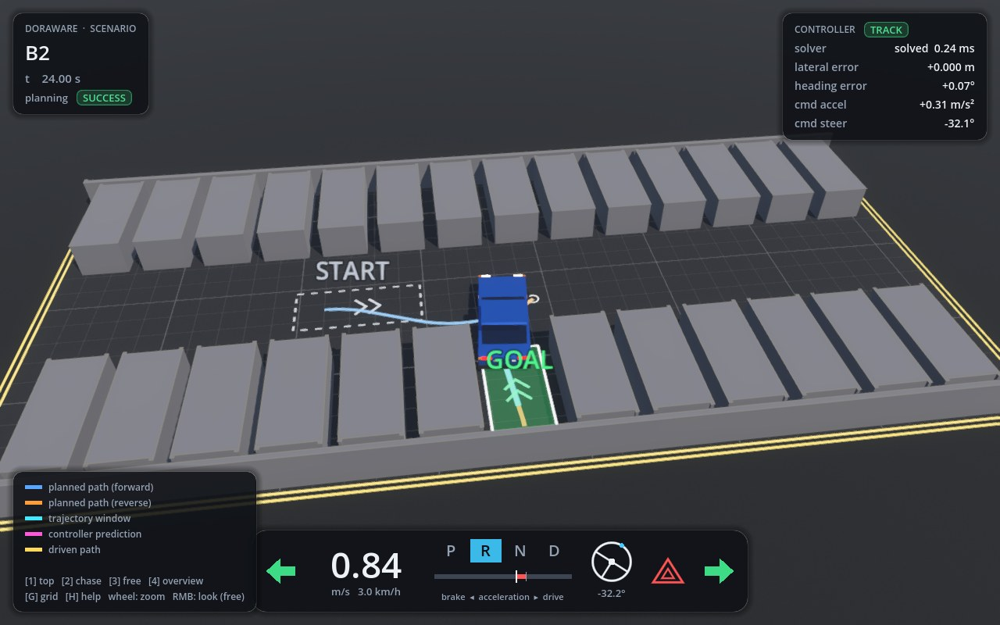

# doraware

**doraware is an open, modular autonomous-driving platform built on [Dora](https://github.com/dora-rs/dora).**

Its components (planning, control, and later localization and perception) are independent Dora
nodes. They talk only through typed message interfaces, and their algorithms are plugins you can swap.
A deterministic physics simulator and an evaluator are part of the platform, so every change can be
verified in closed loop on a simulated vehicle, reproducibly.



```text
                         ┌──────────────── doraware ────────────────┐
  sensors / simulator ─► │ localization* ─► perception* ─► planning │
                         │                                   │      │
                         │                    trajectory ◄───┘      │
                         │                        │                 │
  vehicle / simulator ◄─ │ control (MPC) ◄────────┘                 │
                         └──────────────────────────────────────────┘
  evaluation (metrics, pass/fail) · recording (MCAP) · replay — observers, off the control path
                                                                   * planned
```

## Why doraware

* **Dora-native.** Components are Dora nodes connected by a dataflow YAML: zero-copy Arrow messages,
  per-node processes, and Python, Rust or C++ nodes in the same system.
* **Interfaces first.** The typed messages in `doraware.interfaces` are the only contract between
  components. You can replace any component without touching the others.
* **Everything is a plugin.** Planners, controllers, simulator backends and scenario sources are selected
  by configuration from registries, and separately installed packages can add their own through Python
  entry points. A planner can be classical (search, sampling) or learning-based.
* **Verification built in.** Lockstep simulation with Godot (Jolt physics) is bit-identical with or without
  the GUI. Metrics and verdicts are computed from the simulated vehicle, never from the plan. Every run is
  recorded and can be replayed.

## Status

| Area | Available now | Planned |
|---|---|---|
| Planning | State Lattice planner plugin (parking), path → time-based trajectory generation, turn indicator / hazard light decision | Diffusion Planner and other trajectory-output planners, lane driving |
| Control | LTV-MPC plugin (OSQP): acceleration and front-wheel steering, gear manager, delay compensation, safe fallback | |
| Localization / Perception | perception message contract (`PerceivedObjects`); the simulator publishes ground truth in it, and the GUI draws any perception output | localization, perception, sensor simulation |
| Simulation | Godot 4.7 backend: planar vehicle with tire model, actuator delays and limits, gears, turn indicators and hazard lights, collisions, deterministic lockstep, 3D GUI | richer scenes, traffic, sensors |
| Evaluation | closed-loop scenario suites, regression baseline, MCAP recording, replay | |

With the parking planner, all 107 fixed and 100 random scenarios pass in closed loop. The median goal
error is 7 mm / 0.19° and there are no collisions. See [docs/evaluation.md](docs/evaluation.md).

## Quick start

Requirements: Linux x86_64, git, Python 3.12 via [uv](https://docs.astral.sh/uv/), and
Godot **4.7.2-stable** (the official binary).

```bash
git clone --recursive https://github.com/yukkysaito/doraware.git && cd doraware
GODOT_BIN=/path/to/Godot_v4.7.2-stable_linux.x86_64 ./scripts/setup.sh   # or: ./scripts/setup.sh --download-godot
source .venv/bin/activate

doraware run --scenario B2 --gui --set timing.realtime_factor=1.0   # watch one parking scenario
doraware run --scenario B2                                         # headless, as fast as possible
doraware run --suite all --random 100 --workers 8                  # every scenario
doraware regression                                                # compare with tests/regression/baseline.json
doraware replay states results/runs/<run>/<scenario>               # offline metrics + plot from a recording
```

Each run writes `result.json`, `recording.mcap` (which you can open in Foxglove), the logs, and the exact
`config.yaml` / `dataflow.yml` to `results/runs/<timestamp>/<scenario>/`. Every parameter is in
[`configs/default.yaml`](configs/default.yaml), and you can override it with `--set key.path=value`.

### The simulator GUI

The GUI shows the planned path (blue forward, orange reverse, white rings at gear changes), the current
trajectory window, the controller's prediction and the driven path. The car model shows steering, brake,
reverse and indicator lamps. The HUD shows the scenario and planning status, the controller state, and an
instrument cluster with speed, gear, acceleration, steering angle, turn indicators and hazard lights.

| Key | Action |
|---|---|
| `1` / `2` / `3` / `4` | top view / chase / free fly / overview camera |
| mouse wheel | zoom (top, overview), distance (chase), speed (free fly) |
| `W` `A` `S` `D` `Q` `E`, right mouse button | move and look (free fly) |
| `G` / `H` | toggle the grid / the legend and help |

Screenshots for documentation: `--set "simulation.screenshot_times=[5.0]" "simulation.screenshot_cameras=[overview]"`.

## Extending doraware

| You want to add | Where | Selected by |
|---|---|---|
| a path planner | `planning/plugins/<name>/` + `planning/registry.py` | `planning.planner.type` |
| a trajectory-output planner (e.g. Diffusion Planner) | `planning/trajectory_planning/plugins/<name>/` + its `registry.py` | `planning.trajectory_planner.type`, run with `--dataflow dataflows/trajectory_planner.yml` |
| a controller | `control/plugins/<name>/` + `control/registry.py` | `control.controller.type` |
| a simulator backend | `simulation/plugins/<name>/` + `simulation/registry.py` | `simulation.backend` |
| a scenario source | `evaluation/scenarios/` + its `registry.py` | `evaluation.scenario_source` |
| a component (perception, localization, …) | `src/doraware/<component>/` + `interfaces/<domain>.py` | a dataflow |

Plugins in separate pip packages register through entry points (`doraware.planners`,
`doraware.trajectory_planners`, `doraware.controllers`, `doraware.simulators`, `doraware.scenario_sources`). The step-by-step guide with
code skeletons is [docs/extending.md](docs/extending.md).

## Repository layout

```text
src/doraware/
  interfaces/      typed messages per domain + Arrow codec            ← the contract between components
  core/            config, clock, lockstep barrier, plugin registry, geometry, Dora node runtime
  planning/        planner node + registry, plugins/state_lattice, trajectory_generation/,
                   trajectory_planning/ (node + registry for trajectory-output planners), signals/
  control/         controller node + registry, gear manager, delay compensation, plugins/mpc
  simulation/      sim bridge node, lockstep coordinator, backend contract + registry, plugins/godot
  evaluation/      evaluator node, metrics, judge, scenarios/ (sources + registry), suite/ (runner, regression)
  recording/       MCAP recorder node, replay
  cli.py           the `doraware` command
dataflows/         Dora dataflows: closed_loop.yml (path planner), trajectory_planner.yml
configs/           parameters, one section per package
simulator/godot/   Godot project: scripts/sim (vehicle physics, actuators) and scripts/gui (3D view, HUD)
tests/             unit/<package>/, integration (Godot), e2e (closed loop), regression baseline
third_party/       State Lattice planner (git submodule)
```

A component's Dora entry point is always `src/doraware/<component>/node.py`. Everything else in the
package is plain Python that can be tested without Dora.

## Documentation

* [Architecture](docs/architecture.md): design principles, components, package layout, messages, time,
  lockstep, simulator backend and protocol, configuration
* [Extending](docs/extending.md): adding planners, components, controllers, simulator backends and scenarios
* [MPC](docs/mpc.md): model, linearisation, cost, constraints, gear handling
* [Testing](docs/testing.md): test levels, scenario classes, acceptance criteria
* [Evaluation](docs/evaluation.md): reference results and known limitations
* [Contributing](CONTRIBUTING.md)

## License

[Apache License 2.0](LICENSE). The State Lattice planner submodule has its own license (Apache 2.0).
